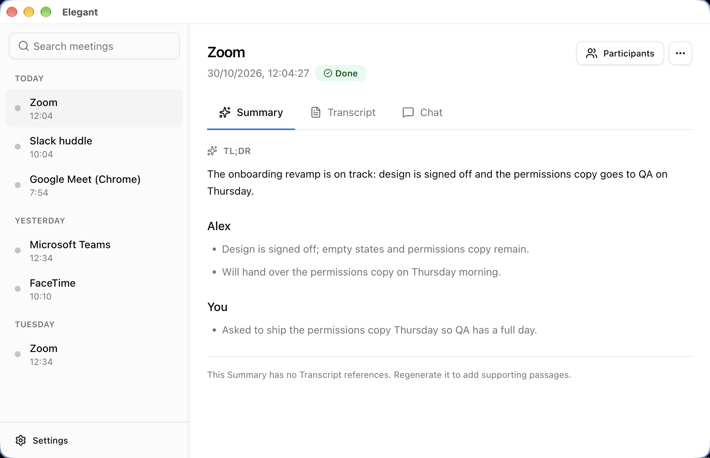
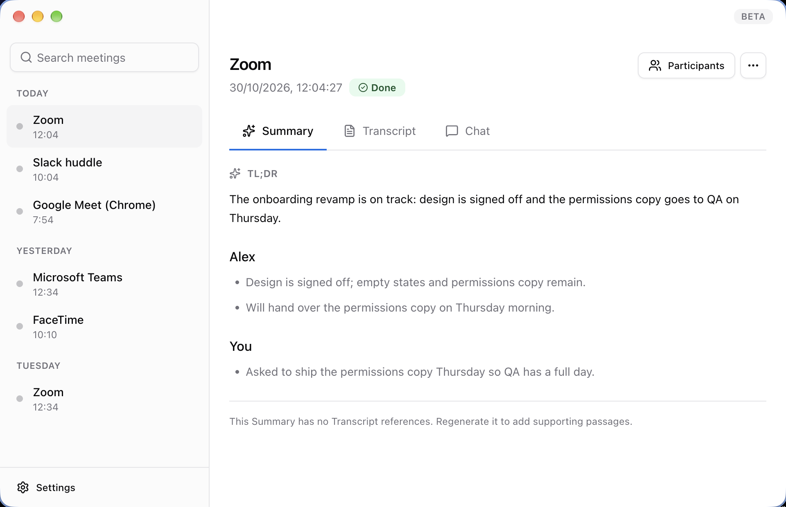
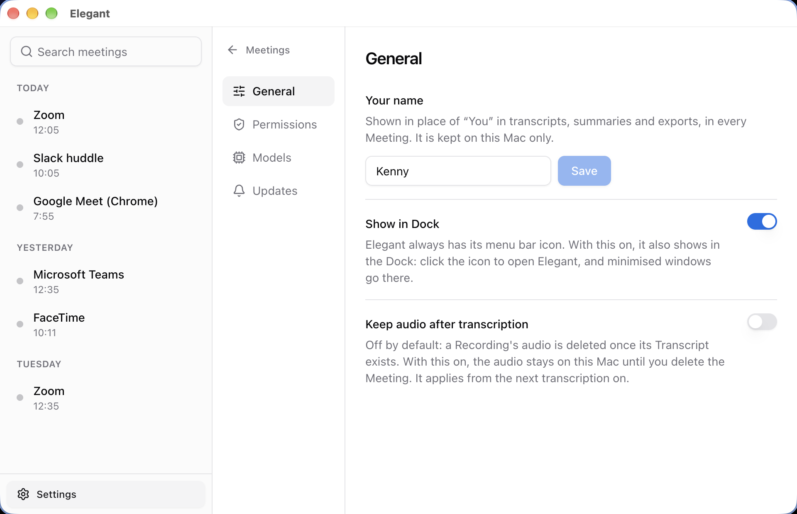
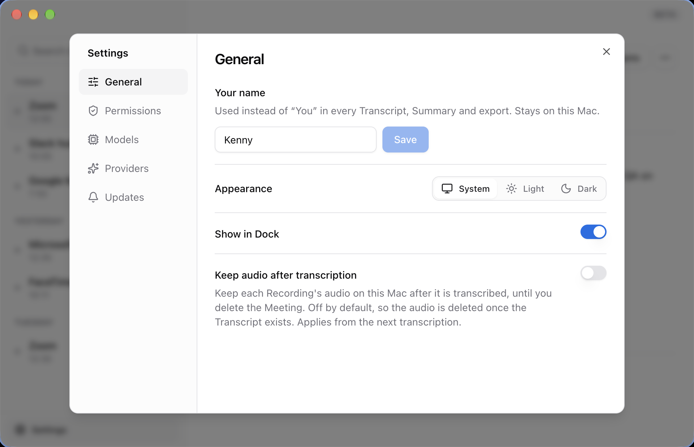
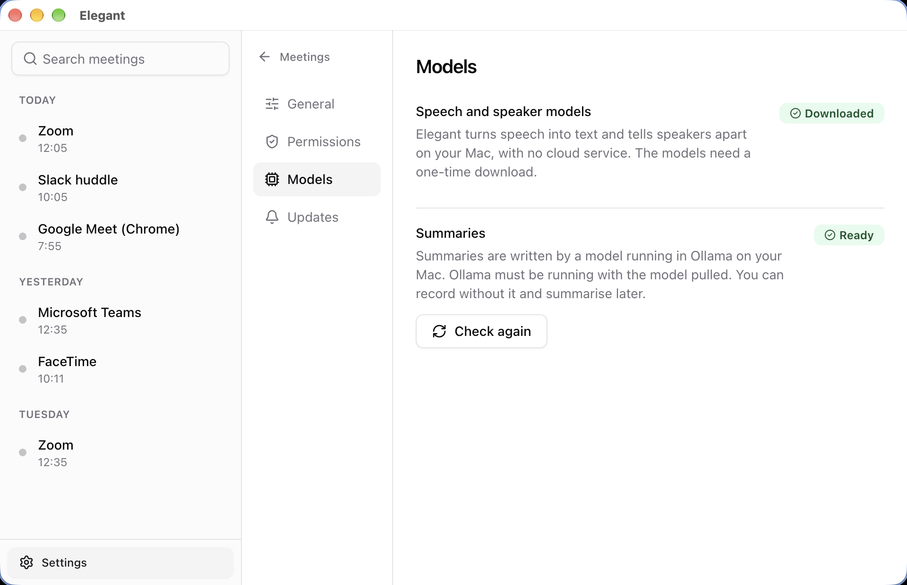
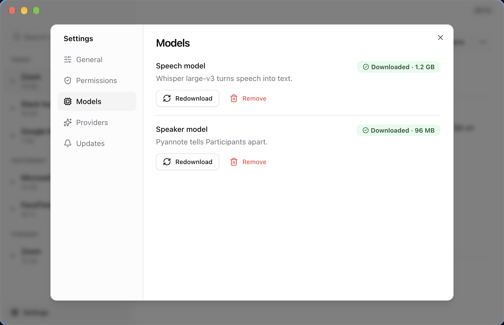
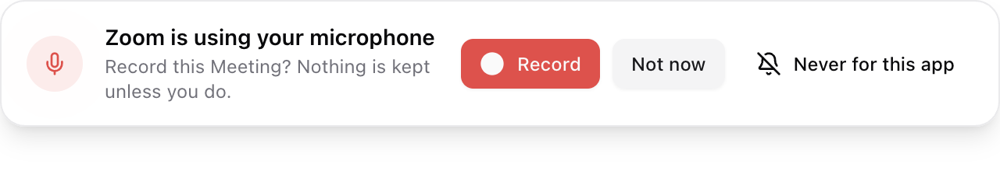
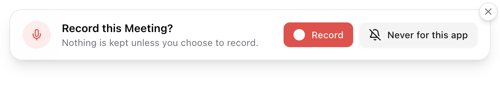
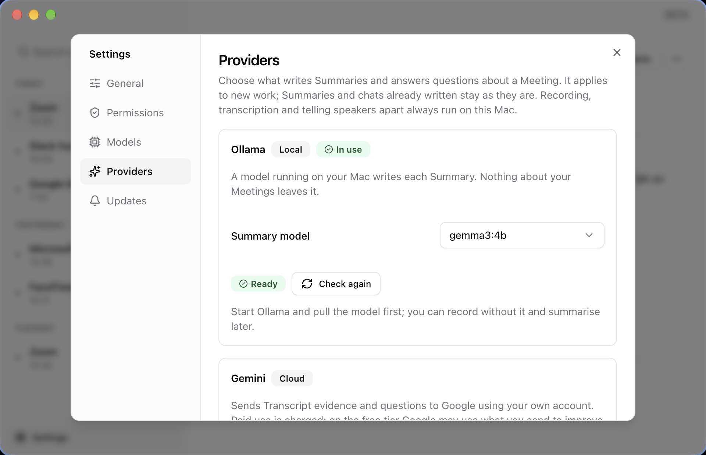

# Elegant changelog: 30 October 2026

Everything below merged into `main` on 30 October 2026 (PRs #65, #67, #68, #71, #72, #73, #74) and shipped as [v0.1.3](https://github.com/BrandNewDevs/Elegant/releases/tag/v0.1.3), published at 12:36 IST. The release is the first with in-app updates; that work (#66) merged on 29 October.

Open [`explainer.html`](./explainer.html) in a browser for the same notes with the Previous UI and Updated UI screenshots side by side.

## Summary

- **Gemini is now an option.** Summaries and Meeting Chat can run on Google's Gemini with your own API key. Ollama is still the default and nothing switches on its own.
- **Settings is a modal.** It opens over the Meetings window instead of replacing the Meeting, and gains Appearance, Models and Providers.
- **The Prompt stays until you answer.** Not now and the timeout are gone, replaced by a close button.
- **Better TL;DRs.** A TL;DR that ran over its word limit now recovers instead of failing, and the overview leads with final decisions and commitments.
- **Branding.** Elegant logos for the app, Dock and menu bar, and a Beta label.

## New

- **Optional Gemini processing** for Summaries and Meeting Chat (#71, [ADR 0003](../../adr/0003-optional-gemini-processing.md)). It needs your own API key, which is kept with Electron's OS-backed `safeStorage` and never sent to the renderer. Using it needs a consent step, and there is no automatic fallback between providers. Audio, transcription and speaker detection stay on the Mac. Details in [`docs/gemini.md`](../../gemini.md).
- **Providers tab in Settings** (#74). One card per provider: Ollama (local) holds the Summary model picker and its readiness check; Gemini (cloud) holds the key, model, connection test and consent. The card in use is marked.
- **Gemini model list from Google's API.** After a key is saved, the model field becomes a picker filled from Google's models endpoint, with a refresh button. Only the key is sent for this, never Meeting content.
- **Find usable models.** Google lists models the key's plan cannot use, so this sends each one a tiny synthetic request, with progress and a Stop button, and the picker then offers only the models that answered.
- **Appearance setting** in Settings > General: System, Light or Dark, applied to every window including the Prompt (#72).
- **Summary model picker** for Ollama, listing the models you have pulled. `gemma3:4b` is the default and the only model that has passed the evaluation gates; any other choice is flagged as untested.
- **Speech and speaker models in Settings > Models**, each with its size on disk, plus Remove and Redownload. Both ask first and are refused while a download, a Recording or AI work is running.
- **Elegant logos** as the bundle icon, the Dock icon and the menu-bar template image; the logo sources are in `docs/brand`.
- **Beta label** on the Meetings window.

## Improved

- **The Prompt no longer times out.** It stays until you answer or the Meeting ends, and clicking elsewhere does not dismiss it. Closing it discards the buffered audio, and Elegant does not ask again about that app until it releases the microphone (#72).
- **TL;DR selection** (#65, #73). The overview reserves space for explicit final decisions, then first-person commitments, then updates and unresolved status. Earlier proposals rank lower but stay in the per-Participant points. The summary prompt moved from `readable-summary-v13` to `v15`.
- **Gemini quota errors** now name the quota, the model and the retry delay, and say when the limit is zero because the model is not on your plan. Google's free-text message is still never shown.
- **The Gemini setup was checked against Google's current docs.** The connection test and model probe now allow 2,048 output tokens, because thinking tokens count against the cap. The consent text says that on the free tier Google may use what you send to improve its products.
- **Settings copy** is shorter and uses the glossary's terms. Settings that explain themselves (Appearance, Show in Dock, Check for updates) lost their descriptions.
- **Provider confirmations are toasts.** A saved or removed key and a passed connection test show as toasts; a failed change stays as an alert beside the controls until fixed.

## Fixed

- **TL;DR over the 90-word limit.** Three valid 57-word points reproduced a 171-word overview that the app rejected. The overview now packs whole supported sentences within three sentences and 90 words, and the TL;DR keeps main updates and first-person attribution (`Speaker 1: …`) (#65).
- **Dock window list read "Meetings".** The page's own `<title>` was replacing the window title. The Meetings and onboarding windows now keep the app's name.

## UI

- **Settings is a modal** over the Meetings window, with the Meetings blurred behind it. The close button, Esc and a click outside all close it, and the open Meeting stays where it was.
- **The title bar is a transparent drag strip.** The traffic lights sit inside the window and content runs to the top edge. The strip no longer shows the app's name, and the Beta label sits at its right edge.
- **The Prompt has a close badge** on its top-right corner (also Esc) in place of Not now, and its heading no longer names the app.
- **Every toast has a close button** on its top-right corner.
- **The model picker** uses shadcn's Select, and the default model is no longer labelled "(tested)".
- **Settings sections** are now General, Permissions, Models, Providers and Updates. The Summary model picker moved from Models to Providers.

## UI comparison

"Previous UI" is `main` right after #67 and #68 merged at 10:41 IST (`534a38b`). "Updated UI" is the same code with the day's work on top. Both sets were rendered from the built renderer with the same synthetic Meeting data, not from the packaged app. See [Known issues](#known-issues).

| Previous UI | Updated UI |
| --- | --- |
|  |  |
| The native title bar says "Elegant". | The window runs to the top edge; the strip is transparent and carries only a Beta label. |
|  |  |
| Settings replaces the Meeting in the main area, with four sections. | Settings floats over the Meetings, with five sections and a new Appearance control. Fewer descriptions. |
|  |  |
| Models mixes the speech and speaker models with Ollama's readiness check. | Models is only the speech and speaker models, with sizes and Remove and Redownload. |
|  |  |
| The Prompt names the app and offers Not now. | A close badge replaces Not now, and the heading no longer names the app. |

The Providers tab is new, so it has no Previous UI:

## User impact

- **Nothing changes for local use.** Ollama stays the default, its prompts and generation are unchanged, and a Summary you already have is not rewritten when you change provider.
- **Using Gemini sends Transcript evidence and questions to Google.** You opt in once, in Settings, and the consent text says so, including the free-tier data-use point. Audio is never uploaded.
- **The Prompt will not vanish while you are busy.** You have to answer or close it.
- **Settings no longer hides your Meeting.** You can open and close it without losing your place.
- **0.1.3 is the first release with in-app updates**, so getting to it from an earlier build is a manual download; from here on the app updates itself in place.

## Checks

Run on `origin/main` at `4d07793`, the commit `v0.1.3` points to:

- `pnpm run typecheck` passed.
- `pnpm exec vitest run` passed: 53 files, 791 tests. The four real-engine tests need the built Swift engine, so they ran against an existing local build.
- `pnpm test` as a whole was not run, so the Swift engine's own tests (`swift test`) were not run for this changelog.
- The screenshots were taken by loading the built renderer in Electron and capturing the window; the Previous UI side was built from `534a38b` the same way.

## Known issues

- **Gemini has not been tried with a live key.** `docs/gemini.md` records that the Google documentation check was read-only. The generation-config field names `responseMimeType` and `responseJsonSchema` could not be confirmed from the reference, so a passing **Test Gemini connection** is the real check. Live quality, latency and usage comparisons with Ollama are still pending.
- **Keychain behaviour is unverified on a signed Mac app**: key save, replace, remove and restore after relaunch, and a locked keychain.
- **Google calls `generateContent` legacy but supported** and recommends the Interactions API. Elegant stays on `generateContent` for now.
- **"Find usable models" spends a little of each model's quota**, and `gemini-4-argon` is paid only, so on a free key it is left out.
- **TL;DR ranking uses narrow English cues.** It does not establish that a later decision replaces an earlier one, and three sentences can still leave out an important detail. The per-Participant points keep everything.
- **Only `gemma3:4b` has passed the evaluation gates.** Other Ollama models are allowed but flagged.
- **The screenshots use stubbed data**, so they show no real Ollama or Gemini state. Toasts with a close button and the Dark appearance have no screenshots.
